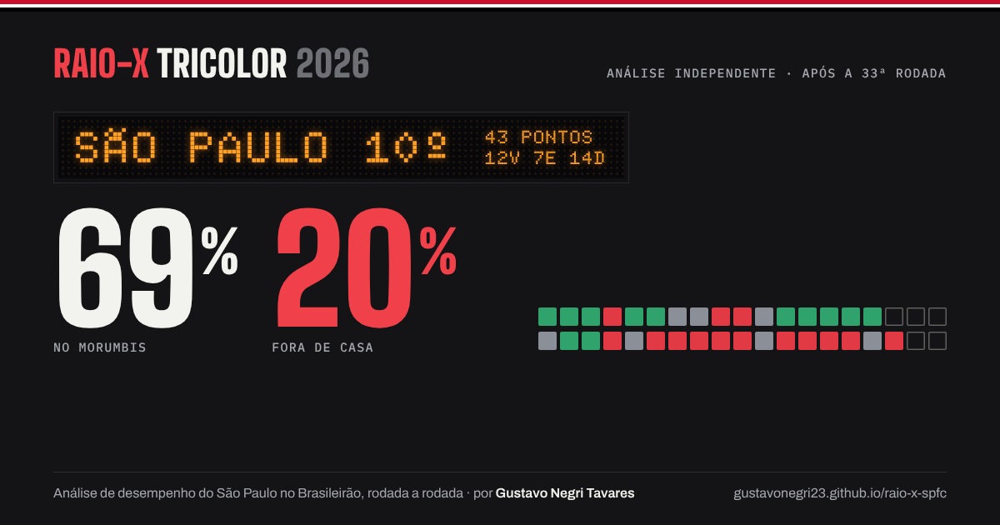
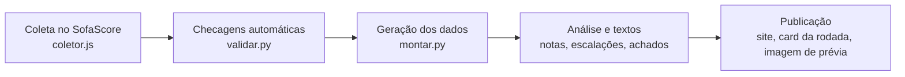

<a href="https://gustavonegri23.github.io/raio-x-spfc/"></a>

# Raio-X Tricolor 2026

**Análise de desempenho independente do São Paulo FC no Brasileirão Série A 2026, atualizada a cada rodada.**

**[Abrir o relatório →](https://gustavonegri23.github.io/raio-x-spfc/)**

Dados públicos do SofaScore e probabilidades do Modelo ValorFinal. Projeto não oficial, sem vínculo com o clube. Feito por Gustavo Negri Tavares.

## O que tem no relatório

O site é organizado como uma reportagem em quatro capítulos, cada um respondendo a uma pergunta:

| Capítulo | Pergunta | O que mostra |
|---|---|---|
| **01 · A temporada** | O que aconteceu? | Trajetória rodada a rodada, troca de técnicos e campanha nas copas |
| **02 · O diagnóstico** | Por que o time perde pontos? | Mando de campo, confrontos, clássicos, finalização (xG), mapa de chutes, minuto do jogo, sistema tático e GPS |
| **03 · O elenco** | Quem sustenta o time? | Dependência do ataque, impacto de cada jogador em campo e ficha individual com mapa de calor |
| **04 · A reta final** | O que fazer agora? | Prioridades, simulador das rodadas restantes e escalação sugerida para cada jogo |
| **Epílogo · Método e acerto** | Dá para confiar? | Fontes, checagens e o placar das previsões feitas antes de cada jogo |

## Como é atualizado



- **Checagens antes de publicar:** placar × lista de gols, mapa de chutes, tabela × campanha, minutos e notas plausíveis. Se um número não fecha, a publicação para ou sai com selo de dados incompletos.
- **Previsões com registro:** a escalação sugerida e o palpite ficam gravados antes do apito e não são editados depois. O placar de acertos é calculado automaticamente, ao lado do favorito do modelo e do índice de Brier.
- **Partes que se atualizam sozinhas:** a campanha da capa, o placar do próximo jogo, o simulador, as fichas dos jogadores, o card da rodada e a imagem de prévia leem os dados gerados, sem texto copiado à mão.

## Estrutura

```
raio-x-spfc/
├── index.html               relatório: capa + capítulos (Temporada, Diagnóstico, Elenco, Reta final, Método)
├── og-card.png              imagem de prévia do link e do topo deste README (gerada por gerar-og.js)
├── data/
│   ├── dados.js             dados da rodada atual (gerado pelo montar.py; não editar à mão)
│   ├── notas.js             "leitura do analista" de cada jogador (texto, editado a cada rodada)
│   ├── escalacoes.js        escalações sugeridas para os próximos jogos e atualizações pré-jogo
│   ├── previsoes.json       previsões registradas antes de cada jogo (fonte; editar só para registrar novas)
│   ├── previsoes.js         placar das previsões (gerado pelo montar.py)
│   ├── card-base.js         números do card da rodada (gerado pelo montar.py)
│   ├── card.js              textos do card da rodada (manchete e 3 destaques)
│   └── rodadas/
│       └── rodada-NN.json   foto completa de cada rodada, como saiu do coletor (fica só na pasta local)
├── relatorios/              resumos, pré-jogo e card PNG de cada rodada (fica só na pasta local)
├── ferramentas/
│   ├── coletor.js           roda no navegador, numa aba do sofascore.com
│   ├── montar.py            checa a coleta e gera data/dados.js, previsões, card-base e o resumo
│   ├── validar.py           checagens automáticas (o montar.py chama sozinho)
│   ├── extras.py            janelas, substituições, vizinhos, previsões e retrospectiva
│   ├── card.html            molde do card da rodada (1080×1350)
│   ├── gerar-card.js        gera relatorios/card-rodada-NN.png
│   ├── og.html              molde da imagem de prévia (1200×630)
│   └── gerar-og.js          gera og-card.png
├── ideias.md                backlog de upgrades, em ordem de prioridade
└── CHANGELOG.md             o que mudou em cada atualização
```

## Atualização depois de cada rodada

1. Abrir uma aba em `https://www.sofascore.com` no navegador do app do Claude.
2. Executar `ferramentas/coletor.js` na aba e as etapas `RX.e1()` a `RX.e4()`.
3. Ler o resultado com `RX.partes()` e `RX.parte(i)` e salvar em `data/rodadas/rodada-NN.json`.
4. Rodar `python3 ferramentas/montar.py` (para se as checagens acharem erro).
5. Ler `relatorios/resumo-rodada-NN.md` e atualizar os textos de `index.html` (capa e capítulos), `data/notas.js` e `data/escalacoes.js`.
6. Escrever `data/card.js` e rodar `node ferramentas/gerar-card.js` e `node ferramentas/gerar-og.js`.
7. Fazer um upgrade de `ideias.md`, registrar em `CHANGELOG.md` e publicar.

O passo a passo completo está na skill "Atualizar Raio-X SPFC". Pasta de trabalho: `C:\Users\gusta\Documents\raio-x-spfc`.

## Abrir localmente

Basta abrir `index.html` no navegador. A página carrega os arquivos de `data/` pelo caminho relativo, então a pasta precisa ficar inteira. Links diretos funcionam por capítulo (`#diagnostico`), por seção (`#s-shots`) e por jogador (`#j-luciano`).

## Fontes e crédito

Estatísticas, notas, mapas de calor, GPS e chutes: SofaScore. Probabilidades: Modelo ValorFinal (CC BY 4.0). Os dados pertencem às fontes; este projeto apenas os analisa.

Análise, código e design: **Gustavo Negri Tavares**.
